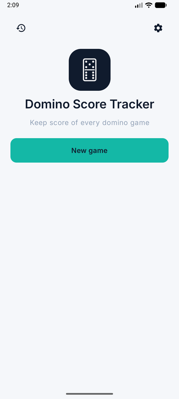
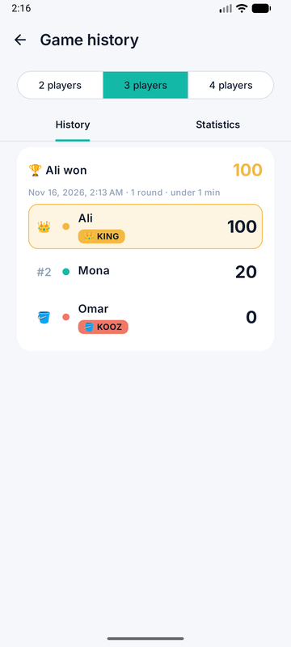
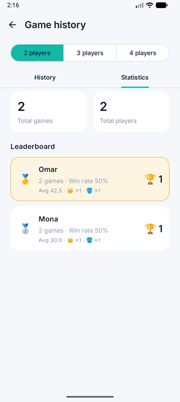
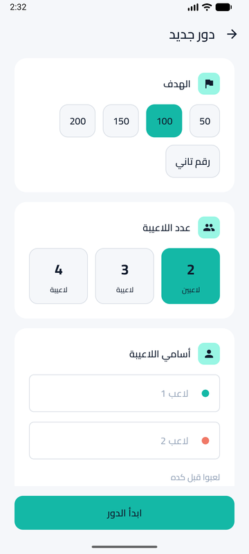
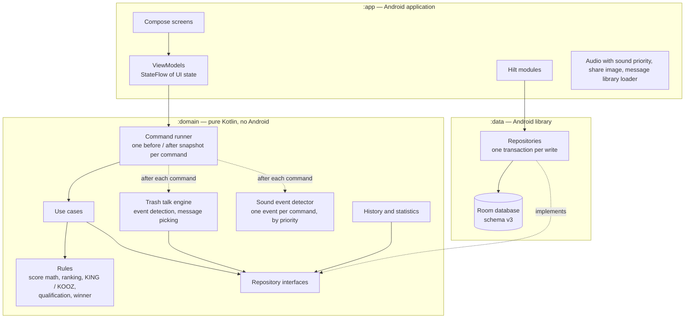
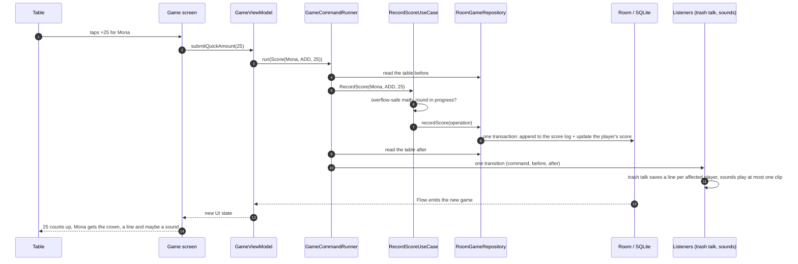

# kotlin-domino-score-tracker

[](https://github.com/khaledX5/kotlin-domino-score-tracker/actions/workflows/ci.yml)


**An offline Android app that keeps the score of a real domino table. Two to four players, every point saved the moment it is tapped, and a bit of Egyptian trash talk for whoever is last.**

It does not play domino. The table plays; the app counts. It adds and subtracts points, ranks the players live, marks the leader as KING 👑 and the last one as KOOZ 🪣, asks the table to confirm the winner, and keeps the history and statistics of every finished game.

<p>
  
  
  
  
</p>

---

## Contents

- [Why I built it](#why-i-built-it)
- [What it does](#what-it-does)
- [Quick start](#quick-start)
- [Architecture](#architecture)
- [The life of one score](#the-life-of-one-score)
- [Data model](#data-model)
- [Design decisions and trade-offs](#design-decisions-and-trade-offs)
- [Testing](#testing)
- [Project structure](#project-structure)
- [Release builds](#release-builds)
- [Limitations](#limitations)

---

## Why I built it

At our table the score is kept on a piece of paper. The paper gets wet, the sums are argued about, and nobody remembers who won last week. Score apps exist, but they are built for card games, full of ads, and none of them speaks the way the table does.

So this is a small product for a real table, and also the place where I hold Android code to the same standard as my backend work: business rules in plain Kotlin with tests first, a database that survives a killed app, migrations that are tested, and a build that fails on unformatted code or a lint warning.

## What it does

| The table needs | What the app does |
| --- | --- |
| Points that can go below zero | Scores are signed whole numbers; a penalty can take anyone under 0. Overflow is caught, not wrapped. |
| To always see who is ahead | A live ranking with shared places (150, 100, 100, 50 → 1, 2, 2, 4). The leader is KING, the last is KOOZ, and nobody holds a title while everyone is equal. |
| To play to 100 today and 150 tomorrow | The target is chosen at setup and can be raised in the middle of a game. Whether a player qualified is always worked out again from the current target. |
| The table decides who won | When someone reaches the target, the only way forward is to confirm a winner or raise the target. A tie at the top is never decided by the app. |
| A phone that dies mid-game | Every tap is written to the database in one transaction. A killed app or a restart opens the exact same game. |
| Some fun | 111 approved Egyptian Arabic lines in 22 categories react to what really happened: a comeback, losing the crown by one point, falling from first to last. Never the same line twice in a row for a player. |
| "Who wins most at four players?" | History and statistics are split by table size (2, 3 or 4 players) and never mixed. The leaderboard counts official wins only and gives medals to the top three. |
| To hear the big moments | A short sound, once, when a second player qualifies, the top two enter the last 10 points, the last player finally scores, players tie above 25, or a penalty is above 4. One switch in the settings turns them all on or off, and a short line shows on screen either way. |
| To send the result to the group | A share image with the winner, the final ranking, KING and KOOZ, in the app language. |
| Arabic | The whole app in English and Arabic, right-to-left included, with Inter and Cairo fonts bundled. |

No ads, no account, no internet permission. Nothing leaves the phone unless you share it.

## Quick start

You need Android Studio (or a JDK 21 and the Android SDK) and a phone or emulator running Android 8.0 or newer.

```bash
git clone https://github.com/khaledX5/kotlin-domino-score-tracker.git
cd kotlin-domino-score-tracker
./gradlew installDebug
```

Then open **Domino Score Tracker**, tap **New game**, pick a target and the players, and start counting.

| Command | What it does |
| --- | --- |
| `./gradlew installDebug` | Build and install the debug app on the connected device |
| `./gradlew spotlessCheck lintDebug testDebugUnitTest :domain:test assembleDebug` | Everything CI runs: format, lint, all tests, the build |
| `./gradlew spotlessApply` | Format the code (ktlint) |
| `./gradlew assembleRelease` | The shrunk release build, signed when a key is configured (see [Release builds](#release-builds)) |

## Architecture

Three Gradle modules, and the arrows only point one way:



| Module | What it holds |
| --- | --- |
| `:domain` | Every business rule and use case, and the repository interfaces. A plain JVM module: it cannot import Android or Room even by mistake, so the rules run in milliseconds in plain unit tests. |
| `:data` | The Room entities, DAOs, mappers and the repository implementations. Every write that touches more than one row runs in one transaction. |
| `:app` | Compose UI, ViewModels, navigation, Hilt wiring, audio, the share image and the resources in English and Arabic. |

A few rules hold everywhere:

- **Composables only draw.** They read one immutable UI state and send events up. No business decision lives in a composable.
- **The domain decides, the database remembers.** Things that can be worked out from the data (qualified, the primary button, KING and KOOZ while playing) are worked out every time and never stored.
- **Animations follow state.** A score is saved first; the count-up, the floating `+25` and the crown bounce react to the new state and never delay or block a write.

## The life of one score



The screen never waits for the animation, and the animation never waits for the screen: if the app is killed at step 7, the score is there when it opens again.

## Data model

Room, with the schema of every version exported to `data/schemas/` and committed.

| Table | Holds | Notes |
| --- | --- | --- |
| `games` | Target, status (`ACTIVE`, `COMPLETED`, `ABANDONED`), winner, start and end time | At most one game is active; starting a new one marks the old one abandoned, in the same transaction |
| `players` | One seat in one game: name, signed score, color, profile | The id never changes, so a rename keeps the whole score log attached |
| `profiles` | One person across games | Unique by name without case: "Omar" and "omar" are the same person |
| `rounds` | Number, status, times | A completed round is never written again |
| `score_operations` | Every add and penalty: amount, score before and after | Append-only. The game history, the per-round breakdown and the move list are all read from it |
| `game_events` | Target changes, round and game ends, winner, renames | The audit trail of a game |
| `player_messages` | Which approved line each player got, and why | Only the line id is stored; the text comes from the library |
| `final_standings` | Rank, KING and KOOZ of every player when the winner was confirmed | Written once, never updated |

| Version | Change | Migration |
| --- | --- | --- |
| 1 | Games, players, rounds, operations, events | — |
| 2 | `player_messages` | Generated by Room (`AutoMigration`) |
| 3 | `profiles`, `players.profile_id`, `final_standings` | Written by hand: existing data needs filling in (see below) |

## Design decisions and trade-offs

### 1. The rules live in a module that cannot see Android

`:domain` is a Kotlin/JVM module. It has the score arithmetic, the ranking, the KING and KOOZ rules, qualification, the winner suggestion, the trash talk engine and the statistics, and none of it knows what a `Context`, a `ViewModel` or a `@Dao` is. Values are checked where they are made: a `TargetScore`, a `ScoreAmount` or a `PlayerName` that exists is already valid, and a failure comes back as a typed `Outcome`, not an exception.

**Trade-off.** More types and a mapping step in `:data`. In exchange, 211 domain tests run in a couple of seconds, and a rule like "a tie at the top is never decided by the app" is tested in one place instead of in every screen.

### 2. Every tap is one transaction

A score is two writes: append the operation to the log, update the player's total. Ending a round is three: close the round, record the event, open the next round. Each of these runs inside `database.withTransaction`, so a process death between two writes leaves either all of the change or none of it.

The repository checks what the use case already checked (that the round is still in progress, that the player belongs to the game) and throws if not. Those checks never fire in normal use; they are there so that a bug fails loudly instead of corrupting a game.

### 3. Derive, don't store, while the game is running

"Qualified" depends on the score and the target, and the target can change in the middle of a game. Storing a `qualified` flag would mean updating it on every score and every target change, and forgetting it once. So it is never stored: it is computed from the current state every time, and so are the ranking, KING and KOOZ and the main button (`End round` or `End game`).

### 4. ...but freeze the result when the game ends

The rule for KING changed once already during development: when everyone is equal, nobody gets a title. If finished games were ranked again every time the history is opened, a rule change would quietly rewrite old results.

So when the winner is confirmed, the use case ranks the players with the current rules and the repository writes the result to `final_standings` in the same transaction as the winner. History and statistics read those rows and nothing else.

### 5. A person is their name

Each game has its own rows in `players`, so before version 3 the app had no idea that "Omar" in Monday's game is "Omar" in Friday's. Statistics need that.

I chose the rule the table already uses: **the same name, without case, is the same person.** The name key comes from `PlayerName.key` in the domain, the same rule that stops two players in one game from having the same name, so there are not two definitions of "same name". The setup screen shows the people who played before as one-tap chips, so the table sees which person it is picking.

Changing a name during a game follows the same rule. It is locked behind a "Change players" switch that is off by default, so a stray tap never edits a name. Once a name is changed, the seat keeps its id (and its whole score log) but moves to the profile of the new name, so the new name is what the moves, the history and the statistics show.

**Trade-offs.** Two different people called Ali at two different tables are one profile. A typo fixed mid-game leaves an unused profile behind; it never shows anywhere, because the setup chips and the statistics only list profiles that sat in a game. Proper player management (merge, split, delete a person) is a feature for later, not a reason for a login screen now.

### 6. Version 3 is migrated by hand, without rebuilding a table

Room can generate a migration that only adds tables. Version 3 also has to fill data in: link every existing player to a profile by name, and give every completed game its final standings from its final scores. So `Migration2To3` is written by hand, on the `SQLiteConnection` API.

`players.profile_id` is nullable in SQL. SQLite cannot add a `NOT NULL` column that is a foreign key to an existing table; the usual workaround is to rebuild the table (create a copy, move the rows, drop the old one). But `players` is the parent of the score log, and dropping a parent table with foreign keys on runs its `ON DELETE CASCADE`. So the column stays nullable, and both the migration and every new game fill it.

The migration test creates a real version 2 database with completed, abandoned and active games, runs the migration with `MigrationTestHelper`, checks the result against the exported schema, and then opens the file the way the app does, so the migration is tested on both of Room's paths.

### 7. Trash talk is driven by commands, not by the screen

The obvious place to pick a funny line is wherever the ranking is shown. That goes wrong fast: the UI recomposes, a flow emits twice, the screen is rotated, and the same event produces three messages.

Instead the engine wraps the commands: it ranks the players before the score, lets the use case run, ranks them again, detects what happened between the two rankings (15 special events with a fixed priority, plus title changes), picks one line per affected player and saves the choice. The screen only reads the saved lines. Opening the app, scrolling or rotating never produces a message.

The lines come from a JSON file of approved messages and are used word for word. A missing or broken file means no messages and a log line, never a crash. The picker gets its `Random` injected, so the tests decide which line comes out.

### 8. The share image is drawn, not screenshotted

The result image is drawn on a `Canvas` (1080 × 1350, the 4:5 size chat apps show uncropped) from a `ResultCard` that the screen builds from string resources. The renderer only draws text it is given, so the wording and the language stay in the resources, and an Arabic card is mirrored by the same code. The PNG goes to the app cache and is handed to the share sheet through a `FileProvider`, so the app needs no storage permission, and the receiving app can read that one file only.

### 9. The loading screen only shows up when startup is really slow

The system splash (AndroidX `SplashScreen`) stays up until the first database read is done, because that read opens the file and runs any migration, and it is the only thing the first screen waits for. A normal start finishes behind the splash, so there is no second screen.

If the read takes longer than 500 ms, an animated loading screen takes over: the home screen's icon, title and tagline, three dominoes drawn on a `Canvas` sliding in, and a teal bar. The bar sweeps instead of counting up, because the app cannot know how far a database open has got and will not invent a percentage. The moment the read finishes, the screen fades into home; nothing waits for the animation to end. It sits above navigation in an activity scoped `ViewModel`, so rotating the phone or coming back to home never plays it again.

### 10. Sounds and trash talk listen to the same commands

Trash talk (decision 7) and the game event sounds both need the table right before and right after a command. Instead of each wrapping the commands and reading the database twice, a `GameCommandRunner` wraps every score, target change and round end once and hands one `GameTransition` (the command, the table before, the table after) to each listener. Trash talk is one listener; the sounds are another.

The sound detector is a pure function over that transition, so every rule is a plain unit test. Each event is a change from "not true before" to "true after": a tie that just stays a tie, or a final stretch that lasts several taps, plays once. One command plays at most one sound, the highest in a fixed priority order. The audio manager still plays one sound at a time: the winner tune is never interrupted, an event replaces the laugh, a tap on the laugh cuts an event, and a second event within 1.5 seconds is dropped so quick taps never stack.


430 tests, all run on every push. Android code runs on the JVM with Robolectric, so no emulator is needed in CI.

| Module | Count | Runs against | What it proves |
| --- | --- | --- | --- |
| `:domain` | 211 | Plain JVM, in-memory fakes | Score math and overflow, ranking with ties, KING and KOOZ, qualification after target changes, winner selection, every trash talk event and its priority, every game sound event and its priority, message picking without repeats, statistics and leaderboard order |
| `:data` | 26 | Room on Robolectric (real SQLite) | Transactions roll back on failure, the score log and moves, profiles by name, frozen standings, both migrations |
| `:app` | 193 | ViewModels and Compose UI on Robolectric | Every screen's state, full setup and game flows driven through the UI, the share image file, sound priority and cooldown, Arabic strings and plural forms |

Some things I wanted proven, not assumed:

- **A failed write leaves nothing behind.** A test makes the last step of ending a game fail and checks that the round was not closed either.
- **Old phones keep their games.** The migration tests start from real version 1 and version 2 databases with games in progress and finished.
- **No message spam.** A score that changes no standing saves no line, a refused command saves nothing, and the screen only reads saved lines, so recomposing it cannot create one.
- **Equal records always sort the same way.** The leaderboard order is tested down to the last tie-breaker, the profile id.

The domain tests use `FakeGameRepository`, an in-memory implementation of the same contract that the Room repository passes, shared with `:app` as Gradle test fixtures.

## Project structure

```text
.
├── domain/                    Pure Kotlin
│   └── src/main/kotlin/.../domain/
│       ├── model/             Game, Player, Profile, TargetScore, ScoreAmount, PlayerName, Outcome
│       ├── rules/             Ranking, KING / KOOZ, qualification, primary action, winner selection
│       ├── usecase/           Start game, record score, end round, confirm winner, rename, ...
│       ├── command/           GameCommandRunner: one before / after snapshot per command for every listener
│       ├── sound/             Game sound events: detector, priority, thresholds
│       ├── messages/          Trash talk: categories, event detection, picker, engine
│       ├── history/           Round breakdown, completed games, statistics and leaderboard
│       └── repository/        GameRepository, PlayerMessageRepository
├── data/                      Room
│   ├── schemas/               Exported schema of every version (1, 2, 3)
│   └── src/main/java/.../data/
│       ├── local/             Entities, DAOs, mappers, Migration2To3
│       └── Room*Repository.kt
├── app/
│   └── src/main/
│       ├── java/.../          ui/ (screens + ViewModels), navigation/, audio/, share/, messages/, di/
│       ├── assets/            ranking_messages.json, font licenses
│       └── res/               values/ (English), values-ar/ (Arabic), fonts, sounds
├── docs/screenshots/
└── .github/workflows/ci.yml   Format, lint, tests, debug and shrunk release builds
```

## Release builds

The release build is shrunk by R8 (about 3.4 MB instead of 17 MB for debug) and runs on CI on every push, so a missing keep rule fails the build instead of a phone.

It is signed only when a key is configured, and the key never enters git:

1. Create an upload key once:
   ```bash
   keytool -genkeypair -v -keystore upload.jks -alias upload -keyalg RSA -keysize 4096 -validity 10000
   ```
2. Copy `keystore.properties.example` to `keystore.properties` and fill in the passwords. Both files are ignored by git.
3. `./gradlew bundleRelease` writes the signed `.aab` for Google Play.

Without `keystore.properties` the same commands still work and produce an unsigned build.

## Limitations

- **No backup or sync.** Everything lives on one phone. Android's own backup covers the database, but there is no export, and two phones cannot share a game.
- **A person is a name** (see [decision 5](#5-a-person-is-their-name)). There is no screen yet to merge or split profiles.
- **The trash talk lines are Egyptian Arabic only**, by design, in both app languages.
- **Abandoned games are kept but not shown.** History lists completed games only; the abandoned ones stay in the database.
- **Tests run on Robolectric, not on devices.** The UI flows are tested on the JVM; there are no instrumented tests on real hardware yet, so the app was also checked by hand on an emulator in English and Arabic.

## License

[MIT](LICENSE). Inter and Cairo are under the SIL Open Font License; their licenses are in `app/src/main/assets/licenses/`.
